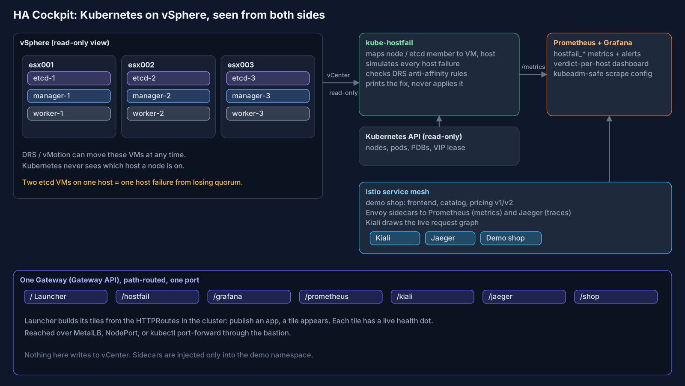

# HA Cockpit for Kubernetes on vSphere

**Your Kubernetes cluster has 3 etcd members and 3 managers. Does it still, after DRS has been busy?**

Kubernetes sees *nodes*. vSphere sees *VMs on hosts*. Neither tells you when two of your three etcd VMs
end up on the same ESXi host, and from then on one host failure takes the control plane down.
This repo closes that gap, and adds a working observability and service-mesh stack for kubeadm clusters
so you can see the result.



## What's in the box

| Component | What it does |
|---|---|
| **[kube-hostfail](kube-hostfail/)** | Read-only. Maps every node and etcd member to its ESXi host, simulates every single-host (and optionally two-host) failure against etcd quorum, API/VIP, workloads, PodDisruptionBudgets and spare capacity, checks DRS anti-affinity, and **prints** the fix (`govc` / PowerCLI). Never changes vCenter. |
| **Prometheus + Grafana** | kube-prometheus-stack tuned for kubeadm: no permanently-red targets, `emptyDir` fallback when there is no StorageClass, opt-in scraping of *external* etcd, a kube-hostfail dashboard and alert rules. |
| **Istio + Kiali + Jaeger** | Sidecar mesh with a 3-service demo shop (two `pricing` versions, one slow and flaky) and a load generator, so the graph and traces are never empty. |
| **App Launcher** | One page, one tile per app, **built automatically from your `HTTPRoute`s** with a live health dot per tile. Publish an app and a tile appears; no config file to edit. |
| **One Gateway, one port** | Everything is path-routed (`/grafana`, `/kiali`, `/jaeger`, `/hostfail`, `/shop`, ...) so a single address, or a single SSH tunnel, reaches it all. |

## Try the core idea in 30 seconds (no vSphere, no cluster)

```bash
cd kube-hostfail && pip install .
kube-hostfail report --snapshot examples/lab-drifted.json --depth 2
```

Output (excerpt):

```
[DOWN] esx002.corp.example   CLUSTER DOWN  etcd 1/3  apiservers 1
       - etcd loses quorum: 1/3 members left, 2 needed (members on esx002: etcd-1, etcd-2)
DRS ANTI-AFFINITY
  etcd   MISSING   fix (review first): govc cluster.rule.create -cluster 'LAB-CL01' -name k8s-lab-etcd-anti-affinity -enable -anti-affinity etcd-1 etcd-2 etcd-3
RESULT: NOT highly available - losing esx002.corp.example takes the cluster down.
```

## Install (from the bastion, as a cluster admin)

Requirements on the machine you run it from: `kubectl`, `helm` 3.x, `python3`, and outbound access to
`github.io`, `kiali.org`, `quay.io`, `docker.io` and `ghcr.io` (or mirror them; see *Air-gapped* below).

```bash
git clone https://github.com/Willey2003/k8s-vsphere-ha-cockpit.git && cd k8s-vsphere-ha-cockpit
cp cockpit.env.example cockpit.env      # optional; every setting has a default

scripts/00-preflight.sh     # READ-ONLY: what exists, what will be created, what could block you
scripts/10-observability.sh # Prometheus + Grafana
scripts/20-mesh.sh          # Istio, Jaeger, Kiali, Gateway
scripts/30-apps.sh          # kube-hostfail, launcher, demo shop, routes
scripts/40-verify.sh        # checks everything, prints the URL
```

Reach it: `http://<gateway IP>/` (MetalLB) or, with no load balancer,
`scripts/port-forward.sh` and then `http://localhost:8080/`. Through a bastion:
`ssh -L 8080:localhost:8080 <user>@<bastion>` and run the port-forward there.

### Live mode (your vCenter)

`30-apps.sh` starts in **demo mode** (replays the bundled drifted-cluster snapshot) so you can see the
product without any vCenter access. For real data, create a vCenter account with the built-in
**Read-only** role and:

```bash
export VSPHERE_SERVER=vcenter.corp.example VSPHERE_USER='svc-hostfail@vsphere.local' VSPHERE_PASSWORD=...
HOSTFAIL_MODE=live HOSTFAIL_CLUSTER_NAME=lab scripts/30-apps.sh
```

If VMware Tools don't report IPs for some VMs, add `HOSTFAIL_VM_MAP="10.0.0.12=etcd-1,..."`.

## Will it disturb an existing cluster?

It is designed not to, and says exactly what it touches:

* **Namespaces it creates:** `cockpit-observability`, `cockpit-system`, `cockpit-demo`, `istio-system`.
* **Cluster-scoped objects it adds:** Prometheus Operator CRDs, Istio CRDs and `ClusterRole`s, Gateway API CRDs
  *only if missing*, and read-only `ClusterRole`s for kube-hostfail and the launcher.
* **Sidecars** are injected only into `cockpit-demo`. Nothing else is restarted or labelled.
* **Control plane:** untouched. Controller-manager, scheduler and kube-proxy are not reconfigured; their
  scrape targets are simply not enabled (kubeadm binds them to `127.0.0.1`).
* **vCenter:** read-only. kube-hostfail only *prints* DRS rules.
* **Resources:** roughly 2.5 CPU / 4 GiB of requests with defaults. `00-preflight.sh` lists node capacity.
* **Uninstall:** `scripts/99-uninstall.sh` (add `--crds` to remove the CRDs too).

If you already run a Prometheus Operator or Istio, read the preflight output before continuing; a second
Istio control plane in one cluster needs revisions, which this repo does not set up.

## "My Prometheus and Grafana never worked on kubeadm"

Run `scripts/k8s-doctor.sh` first. It is **read-only** and checks for the usual causes: Pending PVCs,
control-plane components bound to `127.0.0.1`, external etcd with no scrapeable endpoint, and any targets
Prometheus itself reports down. It tells you which applies and what each fix would touch.

External etcd metrics are opt-in: run `scripts/etcd-client-secret.sh` on a control-plane node, then
`ETCD_METRICS=true ETCD_ENDPOINTS=ip1,ip2,ip3 scripts/10-observability.sh`.

## Security notes (lab defaults)

* Grafana allows **anonymous Viewer** so a tile click lands on dashboards. Admin password is generated at
  install and kept only in the cluster. Set `GRAFANA_ANONYMOUS=false` to require login.
* Kiali runs **view-only** with anonymous auth; Jaeger has no auth. Keep the Gateway on an internal address,
  or put an auth proxy in front, before sharing it.
* The vCenter password lives only in a Kubernetes Secret in `cockpit-system`.
* Demo-grade Jaeger storage (in-memory/badger); traces vanish on restart.

## What has and hasn't been verified

| Verified | How |
|---|---|
| kube-hostfail logic: mapping, quorum, VIP, PDBs, capacity, DRS | 20 unit tests |
| Reading a real vCenter API | end-to-end test against `vcsim` (govmomi's vCenter simulator): builds hosts and VMs, vMotions two etcd VMs together, detects the SPOF, applies the suggested DRS rule, sees it fixed |
| Exporter, web view and `/metrics` | run locally against the bundled snapshot |
| Launcher discovery and health probes; demo trace propagation | run locally against a mock API |
| All Helm charts and manifests | `helm template` and `kubeconform` against Kubernetes 1.33 + CRD schemas (CI) |
| Scripts | `bash -n` and `shellcheck` (CI) |

| **Verified on a real cluster** | first install, Oct 2026 |
|---|---|
| Install end to end | kubeadm 1.32, 3 managers + 4 workers, CRI-O, Calico, MetalLB, external etcd, with another Prometheus stack and Gateway API already present |
| Istio 1.30.5 sidecar mesh, Gateway API Gateway served by Istio | Gateway programmed, 7 routes accepted, address from MetalLB |
| Kiali, Jaeger, Prometheus, Grafana wiring | Kiali reports Prometheus, Grafana and Jaeger reachable; Jaeger holds traces for frontend, catalog and pricing |
| kube-hostfail in demo mode, as a pod, scraped by Prometheus | `hostfail_single_points_of_failure` present |

| **Not yet verified** | |
|---|---|
| `HOSTFAIL_MODE=live` against a real vCenter | the API calls are exercised against `vcsim`, which is not byte-for-byte vCenter |
| Uninstall script on a real cluster | `bash -n` and `shellcheck` only |

Problems the first real run found, now fixed: node-exporter host port clashed with an existing stack on 9100
(ours now uses 9101); Grafana metrics are scraped on `/grafana/metrics`; the ghcr image tag must be lowercase.
Known caveat: if a host firewall blocks port 9101 between nodes, those node-exporter targets show DOWN.
Our Prometheus selects ServiceMonitors in every namespace, so it will also scrape another stack's targets
(read-only extra load). If something fails on your cluster, please open an issue with the output of
`00-preflight.sh` and `40-verify.sh`.

## Model and limits of the simulation

The verdict describes the first minutes after a host dies, before vSphere HA restarts VMs and before
Kubernetes reschedules pods. Not modelled yet: datastore/PV placement, network partitions, DaemonSets,
vSphere HA admission control.

## Air-gapped clusters

Mirror these and override `HOSTFAIL_IMAGE` and the chart/image sources: `ghcr.io/willey2003/kube-hostfail`,
`python:3.12-alpine`, the `kube-prometheus-stack`, `istio`, `kiali-server` charts and their images,
`quay.io/kiali/kiali`, `docker.io/jaegertracing/jaeger`. An offline bundle script is on the roadmap.

## Layout

```
kube-hostfail/   Python package, tests (unit + vcsim e2e), Dockerfile
launcher/        App Launcher (stdlib only)
demo-shop/       3-service traced demo app
deploy/          Helm values + manifests (rendered with scripts/lib.sh)
scripts/         00 preflight, 10 observability, 20 mesh, 30 apps, 40 verify, 99 uninstall, k8s-doctor, port-forward
docs/            architecture diagram (+ generator)
```

Apache-2.0.
